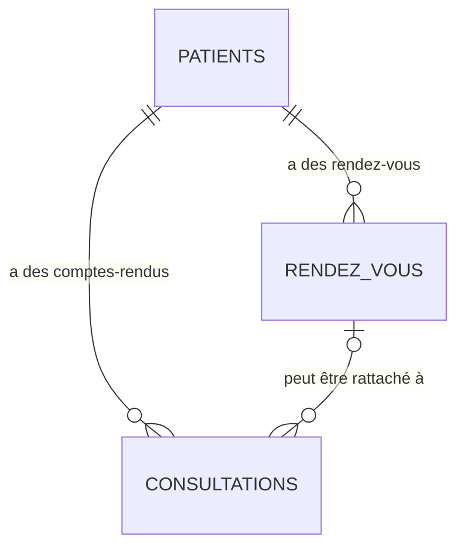
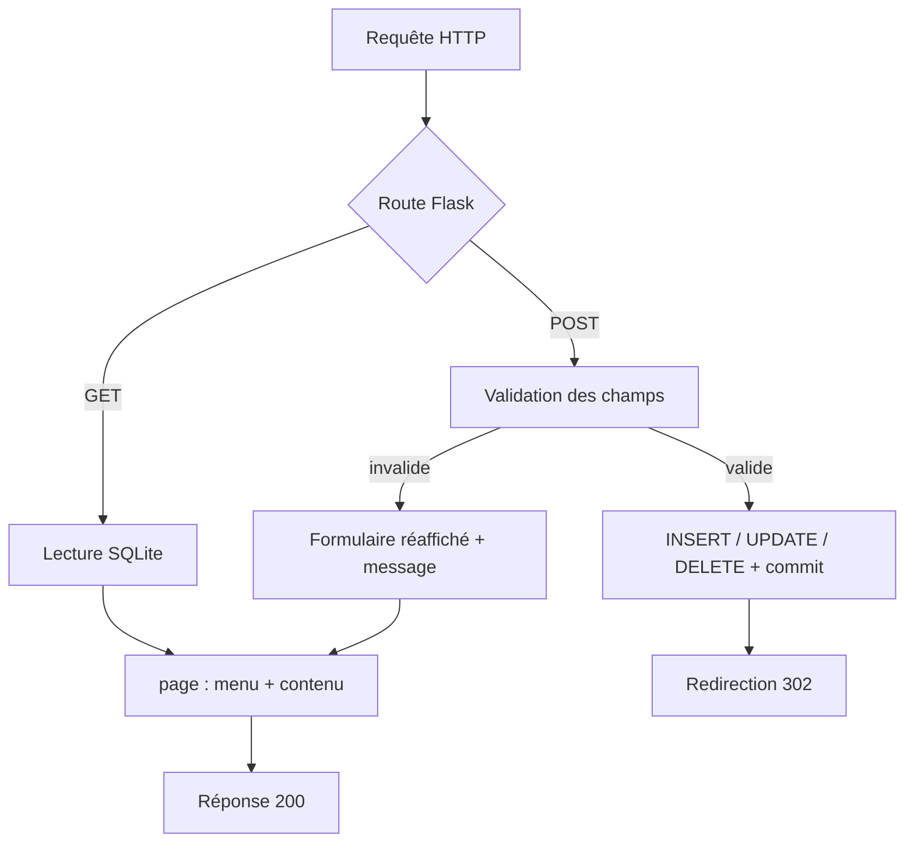

# Spécification — Gestion de cabinet de neurologie

| | |
|---|---|
| Version | 1.3 |
| Date | 2026-10-28 |
| Portée | Application web locale de gestion des patients, rendez-vous et comptes-rendus de consultation |
| Licence | MIT (fichier `LICENSE`) |

## 1. Contexte et objectif

Application Flask mono-utilisateur permettant de :

- gérer le fichier patients (création, consultation, modification) ;
- planifier, modifier et supprimer des rendez-vous, et consulter l'agenda hebdomadaire ;
- rédiger, consulter, filtrer et modifier des comptes-rendus de consultation ;
- naviguer d'un patient vers ses rendez-vous et ses comptes-rendus.

L'application est destinée à un usage local (poste unique, réseau de confiance). Elle ne comporte ni authentification, ni gestion de rôles, ni API JSON : toutes les pages sont rendues côté serveur.

## 2. Stack technique

| Élément | Valeur |
|---|---|
| Langage | Python 3.14 |
| Framework web | Flask 3.1.3 |
| Base de données | SQLite (module standard `sqlite3`) |
| Rendu | Gabarits Jinja2 (`templates/`), CSS externe (`static/style.css`) |
| JavaScript | uniquement la confirmation `confirm()` avant suppression d'un RDV |
| URL locale | `http://127.0.0.1:5000/` |

## 3. Cartographie fonctionnelle

### 3.1 Routes

| Méthode | URL | Fonction | Comportement |
|---|---|---|---|
| GET | `/` | `accueil` | Redirige vers `/patients` |
| GET | `/patients` | `liste_patients` | Liste des patients (nom, prénom, date de naissance), chaque nom mène à la fiche |
| GET, POST | `/patients/nouveau` | `nouveau_patient` | Formulaire de création ; succès → `/patients/<id>` |
| GET | `/patients/<id>` | `fiche_patient` | Identité, rendez-vous et comptes-rendus du patient ; 404 si inconnu |
| GET, POST | `/patients/<id>/modifier` | `modifier_patient` | Formulaire pré-rempli ; succès → `/patients/<id>` ; 404 si inconnu |
| GET | `/rendez-vous` | `liste_rendez_vous` | Tous les RDV (date, heure, durée, patient, motif, statut) avec boutons Supprimer et, sauf si un compte-rendu est lié, Modifier |
| GET | `/agenda` | `agenda` | Vue hebdomadaire du lundi au vendredi (jours ouvrés), grille 08:00–18:00 ; `?semaine=AAAA-MM-JJ` (toute date de la semaine) ; date absente ou invalide → semaine courante ; RDV hors plage listés sous la grille ; RDV du samedi et du dimanche non affichés |
| GET, POST | `/rendez-vous/nouveau` | `nouveau_rendez_vous` | Formulaire de prise de RDV ; `?patient_id=` présélectionne le patient ; succès → `/patients/<patient>` |
| GET, POST | `/rendez-vous/<id>/modifier` | `modifier_rendez_vous` | Formulaire pré-rempli, statut modifiable ; succès → `/rendez-vous` ; 404 si inconnu ; 403 si un compte-rendu est lié au RDV |
| POST | `/rendez-vous/<id>/supprimer` | `supprimer_rendez_vous` | Supprime le RDV ; GET → 405 ; 404 si inconnu ; succès → `/rendez-vous` |
| GET | `/consultations` | `liste_consultations` | Tableau à 3 colonnes (patient, médecin, date), filtre `?medecin=` |
| GET | `/consultations/nouveau` | `nouveau_compte_rendu` | Formulaire de saisie ; `?patient_id=` et `?rendez_vous_id=` présélectionnent ; succès → `/consultations` |
| GET | `/consultations/<id>` | `detail_consultation` | Compte-rendu complet et bouton Modifier ; 404 si inconnu |
| GET, POST | `/consultations/<id>/modifier` | `modifier_compte_rendu` | Formulaire pré-rempli ; succès → `/consultations/<id>` ; 404 si inconnu |

### 3.2 Navigation et présentation

- Menu permanent en haut de page : **Patients**, **Rendez-vous**, **Agenda**, **Consultations**. L'entrée courante est mise en évidence (classe `actif`).
- Le menu et les boutons d'action partagent la forme « bouton » ; le menu est gris (`#555`), les actions sont bleues (`#0066cc`), les suppressions rouges (`.danger`).
- Toutes les pages partagent le même squelette HTML (`<!DOCTYPE html>`, `<head>` avec CSS externe, `<nav>`, `<main>`, `<h1>`) fourni par le gabarit `templates/base.html`.

### 3.3 Domaine « Patients »

**Liste** : une entrée par patient, ordonnée par nom puis prénom (insensible à la casse) ; nom et prénom cliquables ; bouton « Ajouter un patient ».

**Fiche** :
- identité : date de naissance, sexe, téléphone, email, adresse, antécédents ;
- actions : prendre un rendez-vous, modifier le patient, rédiger un compte-rendu ;
- section « Rendez-vous » : date, heure, durée, motif, statut + boutons Supprimer et, sauf si un compte-rendu est lié, Modifier ;
- section « Comptes-rendus de consultation » : date, médecin, motif + boutons Voir / Modifier ;
- messages dédiés si une section est vide.
- section  « Rendez-vous » et « Comptes-rendus de consultation » en parralelle dans la page sous les informations patients

**Création / modification** : formulaire commun ; les champs facultatifs laissés vides sont enregistrés à `NULL`.

### 3.4 Domaine « Rendez-vous »

- Liste globale triée par date puis heure, croissantes.
- Création : patient obligatoire, date et heure obligatoires, durée obligatoire (de 20 à 60 min par pas de 5, 30 min pré-remplies), motif facultatif ; statut forcé à `prévu`.
- Modification : patient, date, heure, durée, motif et statut (`prévu`, `honoré`, `annulé`). Interdite si un compte-rendu est lié au RDV : la route répond `403` et le bouton Modifier n'est pas affiché.
- Chevauchement interdit, à la création comme à la modification : un RDV ne peut pas chevaucher un autre RDV du même jour dont le statut n'est pas `annulé`. Un RDV `annulé` ne bloque pas son créneau et n'est pas bloqué par les autres. Deux RDV qui se touchent (l'un finit à l'heure où l'autre commence) sont acceptés. Le RDV modifié n'est pas comparé à lui-même.
- Suppression : uniquement en `POST`, avec confirmation navigateur. Les comptes-rendus liés sont conservés : leur `rendez_vous_id` est mis à `NULL`.

### 3.5 Domaine « Consultations »

- Liste compacte : patient (lien vers le compte-rendu), médecin, date, triée par date décroissante. Le contenu n'apparaît que sur la page de détail.
- Filtre par médecin (liste des valeurs distinctes non vides) ; valeur exacte ; un médecin sans résultat reste sélectionnable et affiche « Aucun compte-rendu pour ce médecin. ».
- Saisie : patient obligatoire, date obligatoire (pré-remplie au jour courant), rendez-vous facultatif (liste de tous les RDV, libellé « date heure · NOM Prénom · motif »), motif / observations / diagnostic / traitement / médecin facultatifs.
- Détail : patient cliquable, médecin, date, rendez-vous lié éventuel, puis motif, observations, diagnostic, traitement ; `—` pour un champ vide ; bouton « Modifier ce compte-rendu ».
- Modification : même formulaire que la saisie, pré-rempli.

### 3.6 Agenda hebdomadaire

- Semaine du lundi au vendredi (jours ouvrés), une colonne par jour (titre « jour JJ/MM ») et une grille de 08:00 à 18:00. Les RDV du samedi et du dimanche ne sont pas affichés. Une minute vaut 2 px : un RDV démarre à son heure et occupe une hauteur proportionnelle à sa durée.
- Navigation : boutons « Semaine précédente », « Semaine courante » et « Semaine suivante » ; l'intervalle affiché (« Du JJ/MM/AAAA au JJ/MM/AAAA ») est rappelé.
- Chaque bloc renvoie à la fiche du patient ; le style du bloc dépend du statut, et une pastille « CR » signale un compte-rendu lié.
- Un RDV qui commence avant 08:00 ou à partir de 18:00 n'est pas dessiné : il figure dans la section « Hors plage 8 h – 18 h » sous la grille. Un RDV qui commence avant 18:00 et finit après est tronqué à la grille.
- L'application n'enregistre pas de chevauchement (§3.4). Seule une base modifiée hors application peut en contenir ; l'agenda les affiche alors superposés.

## 4. Règles de validation

| Formulaire | Champ | Règle | Message en cas d'échec |
|---|---|---|---|
| Patient | `nom`, `prenom` | non vides après `strip()` | « Le nom et le prénom sont obligatoires. » |
| Patient | `date_naissance` | vide, ou date `AAAA-MM-JJ` valide | « La date de naissance n'est pas valide. » |
| Patient | `sexe` | `""`, `F`, `M` ou `Autre` | « La valeur choisie pour le sexe n'est pas valide. » |
| RDV | `patient_id` | entier désignant un patient existant | « Merci de choisir un patient. » |
| RDV | `date_rdv`, `heure_rdv` | date `AAAA-MM-JJ` et heure `HH:MM` valides | « Merci de saisir une date et une heure valides. » |
| RDV (édition) | `statut` | `prévu`, `honoré` ou `annulé` | « Le statut choisi n'est pas valide. » |
| RDV | `duree_minutes` | entier de 20 à 60 par pas de 5 | « La durée choisie n'est pas valide. » |
| RDV | `date_rdv`, `heure_rdv`, `duree_minutes` | aucun autre RDV du même jour, non `annulé`, ne chevauche le créneau (si le RDV enregistré n'est pas `annulé`) | « Ce créneau chevauche un autre rendez-vous. » |
| Consultation | `patient_id` | entier désignant un patient existant | « Merci de choisir un patient. » |
| Consultation | `rendez_vous_id` | vide, ou RDV existant appartenant au patient choisi | « Le rendez-vous choisi n'existe pas. » / « Le rendez-vous choisi n'appartient pas à ce patient. » |
| Consultation | `date_consultation` | date `AAAA-MM-JJ` valide | « Merci de saisir une date valide. » |

En cas d'erreur : réponse `200`, formulaire réaffiché avec les valeurs déjà saisies, aucune écriture en base. Les champs facultatifs vides deviennent `NULL`.

## 5. Modèle de données

### 5.1 Relations



- Un patient possède zéro ou plusieurs rendez-vous et zéro ou plusieurs comptes-rendus.
- Un compte-rendu référence au plus un rendez-vous ; un rendez-vous peut être référencé par plusieurs comptes-rendus (aucune contrainte d'unicité).

### 5.2 Schéma SQL

```sql
CREATE TABLE patients (
    id INTEGER PRIMARY KEY AUTOINCREMENT,
    nom TEXT NOT NULL,
    prenom TEXT NOT NULL,
    date_naissance DATE,
    sexe TEXT,
    telephone TEXT,
    email TEXT,
    adresse TEXT,
    antecedents TEXT,
    date_creation TIMESTAMP DEFAULT CURRENT_TIMESTAMP
);

CREATE TABLE rendez_vous (
    id INTEGER PRIMARY KEY AUTOINCREMENT,
    patient_id INTEGER NOT NULL,
    date_rdv DATE NOT NULL,
    heure_rdv TIME NOT NULL,
    motif TEXT,
    statut TEXT DEFAULT 'prévu',
    duree_minutes INTEGER NOT NULL DEFAULT 30 CHECK (duree_minutes BETWEEN 20 AND 60),
    FOREIGN KEY (patient_id) REFERENCES patients (id)
);

CREATE TABLE consultations (
    id INTEGER PRIMARY KEY AUTOINCREMENT,
    patient_id INTEGER NOT NULL,
    rendez_vous_id INTEGER,
    date_consultation DATE NOT NULL,
    motif TEXT,
    observations TEXT,
    diagnostic TEXT,
    traitement TEXT,
    medecin TEXT,
    FOREIGN KEY (patient_id) REFERENCES patients (id),
    FOREIGN KEY (rendez_vous_id) REFERENCES rendez_vous (id)
);
```

### 5.3 Règles d'intégrité

- SQLite est utilisé sans `PRAGMA foreign_keys = ON` : les clés étrangères sont déclaratives. L'application vérifie l'existence du patient et l'appartenance du RDV au patient lors de la saisie d'un compte-rendu ; un RDV lié à un compte-rendu n'est plus modifiable (§3.4).
- Dates et heures sont stockées en texte (`AAAA-MM-JJ`, `HH:MM`) ; `date_creation` est renseignée automatiquement.
- La durée est un entier de minutes : la contrainte `CHECK` limite le schéma à 20–60 min, l'application valide le pas de 5 min. Le chevauchement des RDV n'est contrôlé que par l'application (§3.4), pas par le schéma.
- Suppression d'un RDV : `consultations.rendez_vous_id` des comptes-rendus liés passe à `NULL`, les comptes-rendus sont conservés.
- Il n'existe aucune suppression de patient ni de compte-rendu.

## 6. Organisation de l'application

### 6.1 Arborescence

```text
cabinet-neurologie/
├── app.py                  # routes, validation et appels aux gabarits
├── requirements.txt        # dépendances épinglées (Flask 3.1.3, Jinja2, Werkzeug, …)
├── README.md
├── SPECIFICATION.md        # ce document
├── LICENSE                 # licence MIT
├── static/
│   └── style.css           # feuille de style
├── templates/
│   ├── base.html           # squelette commun : head, menu, main
│   ├── macros.html         # messages, champs, listes, boutons
│   ├── patients/           # liste.html, fiche.html, formulaire.html
│   ├── rendez_vous/        # liste.html, formulaire.html, agenda.html
│   └── consultations/      # liste.html, detail.html, formulaire.html
└── database/
    ├── cabinet.db          # base SQLite
    ├── create_db.py        # création du schéma
    ├── peupler_donnees.py  # jeu de données fictif
    └── Description.md      # contexte de création de la base

Le venv local et les fichiers de clés ne font pas partie de l'application et ne sont pas utilisés par celle-ci.

### 6.2 Structure de `app.py`

| Unité | Rôle |
|---|---|
| `PAGES` | Rubriques du menu (adresse + libellé), injectées dans tous les gabarits par `injecter_menu()` |
| `se_connecter_a_la_base()` | Ouvre `database/cabinet.db` avec `row_factory = sqlite3.Row` |
| `CHAMPS_PATIENT`, `SEXES`, `OPTIONS_SEXE` | Constantes et options du formulaire patient |
| `CHAMPS_RDV`, `DUREES_RDV`, `STATUTS_RDV`, `OPTIONS_STATUT`, `OPTIONS_DUREE` | Constantes et options du formulaire RDV (durée de 20 à 60 min) |
| `CHAMPS_CONSULTATION` | Constantes du formulaire de compte-rendu |
| `valeurs_depuis_formulaire()`, `valeurs_depuis_ligne()` | Lecture des champs saisis, ou des lignes SQLite pour pré-remplir un formulaire |
| `erreur_formulaire_patient()`, `valider_rendez_vous()`, `valider_consultation()` | Validation ; toutes les erreurs d'un formulaire sont collectées |
| `options_patients()`, `options_rendez_vous()` | Options des listes déroulantes ; libellé RDV « date heure · NOM Prénom · motif » |
| `rendez_vous_chevauche()`, `lundi_de_la_semaine()`, `position_dans_grille()` | Contrôle de chevauchement des RDV non annulés ; calcul de la semaine affichée et de la position des blocs dans la grille de la route `agenda()` |
| `rendre_formulaire_patient()`, `rendre_formulaire_rendez_vous()`, `rendre_formulaire_consultation()` | Rendu des formulaires via `render_template` |
| Routes | Lecture SQLite, validation, écriture avec `commit()`, redirections, `render_template` pour les pages |

Chaque requête ouvre une connexion SQLite, exécute des requêtes **paramétrées**, appelle `commit()` après écriture et ferme la connexion. Aucun état global n'est conservé entre requêtes.

### 6.3 Cycle d'une requête



### 6.4 Rendu HTML

- Le HTML est rendu par Jinja2 à partir de `templates/` : `base.html` (squelette commun : `<head>`, menu, `<main>`, `<h1>`), `macros.html` (messages d'erreur, champs de formulaire, listes déroulantes, boutons d'action), puis une page par écran sous `templates/patients/`, `templates/rendez_vous/` et `templates/consultations/`.
- Les routes ne construisent aucun HTML : elles transmettent aux gabarits les lignes SQLite, les options de listes et les messages d'erreur.
- L'échappement est assuré par l'autoescape de Jinja2 pour les gabarits `.html`. Les dates, heures et statuts, dont le format est contraint à l'écriture, sont affichés tels quels.
- Le CSS est externe : `static/style.css`, servi par Flask sous `/static/style.css`.
- Les boutons d'action sont des liens `<a class="bouton">` ; les soumissions utilisent `<button>` ; la suppression utilise un formulaire `POST` avec `confirm()`.

## 7. Limites connues

- Aucune authentification, aucun contrôle d'accès, aucun jeton CSRF : usage local uniquement.
- `app.run(debug=True)` : mode développement à ne pas exposer.
- Pas de pagination, de recherche patient, ni de tri configurable.
- Le contrôle de chevauchement (§3.4) ne s'applique que par l'application : une base modifiée hors application peut contenir des RDV qui se chevauchent, que l'agenda affiche alors superposés.
- Email et téléphone non validés côté serveur (seuls les `type="email"` / `type="tel"` HTML guident la saisie).
- Suppression limitée aux rendez-vous ; patients et comptes-rendus ne sont pas supprimables via l'interface.
- Le filtre des consultations porte sur une égalité stricte de la chaîne `medecin`.
- Aucune suite de tests automatisée versionnée.

## 8. Exploitation

Depuis la racine du projet (le chemin `database/cabinet.db` est relatif) :

```bash
python3 -m venv venv
source venv/bin/activate
pip install -r requirements.txt
python3 database/create_db.py          # uniquement si la base n'existe pas
python3 database/peupler_donnees.py    # jeu de données fictif, optionnel
python3 app.py                         # http://127.0.0.1:5000/
```

Base créée avant la version 1.3 : ajouter la colonne `duree_minutes` une seule fois, après une sauvegarde de `database/cabinet.db` :

```bash
venv/bin/python -c "import sqlite3; c = sqlite3.connect('database/cabinet.db'); c.execute('ALTER TABLE rendez_vous ADD COLUMN duree_minutes INTEGER NOT NULL DEFAULT 30 CHECK (duree_minutes BETWEEN 20 AND 60)'); c.commit()"
```

## 9. Vérification

Le comportement décrit a été vérifié avec le client de test Flask sur une copie de la base (routes 200/302/404/405, branches de validation sans écriture, redirections après écriture, échappement des saisies, suppression d'un RDV lié à un compte-rendu, filtre par médecin) et par un lancement du serveur réel (`app.py`) avec requêtes GET sur les pages principales et sur `/static/style.css`.

Version 1.3 (agenda, durée, chevauchement) : vérifiée avec le client de test Flask sur une base temporaire (29 contrôles, puis 14 contrôles de chevauchement, scripts supprimés), puis sur une copie de `database/cabinet.db` migrée (pages principales, `/agenda`, `/rendez-vous/<id>/modifier` en 403 pour un RDV lié à un compte-rendu). Le rendu de la grille a été validé à l'écran.
